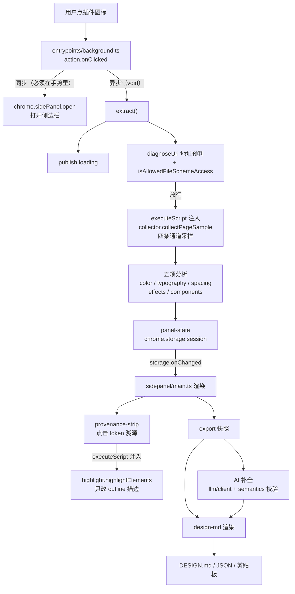

# design-md-extractor 技术文档

> 面向接手后续优化的同事。读完这份文档应当能独立构建、验证、定位模块、并按优先级往下推。
> 生成于 2026-10-13，与代码同版本。
>
> 仓库里另外有一份 `HANDOFF.md`，那是给新会话（另一个 AI）续作用的工作交接，记录了大量
> 「当时为什么这么选」的推理。本文件是给人看的技术文档，两者内容有重叠，但本文件把
> 「怎么理解这套系统」和「还能往哪优化」放在最前面。数值、文件名与断言数量以本文件为准，
> 若有出入以实际代码与 `reports/check-report.md` 为准。

---

## 目录

1. [项目是什么](#1-项目是什么)
2. [快速上手](#2-快速上手)
3. [架构总览](#3-架构总览)
4. [目录与模块地图](#4-目录与模块地图)
5. [关键数据契约](#5-关键数据契约)
6. [运行时硬约束](#6-运行时硬约束改代码前必读)
7. [验证体系](#7-验证体系)
8. [如何扩展](#8-如何扩展常见改动指南)
9. [已知短板与优化机会](#9-已知短板与优化机会)
10. [踩坑速查](#10-踩坑速查)
11. [协作约定与代码风格](#11-协作约定与代码风格)
12. [术语表](#12-术语表)

---

## 1. 项目是什么

一个 Chrome 扩展（Manifest V3）。在任意网页上点一下插件图标，提取该页面的**视觉风格**，
最终产出一份符合 Google `DESIGN.md` 规范（来自 `google-labs-code/design.md`，alpha）的
设计系统文件，供 Cursor / Claude Code 这类编码助手在复刻界面时读取。

一句话概括五段链路：**采集 → 分析 → 生成 → 补全 → 导出**。

| 项 | 值 |
| --- | --- |
| 路径 | `/Users/dqh/dqh/design-md-extractor/` |
| 框架 | WXT 0.21 + TypeScript 7 |
| 运行形态 | Chrome 扩展 MV3，最低 Chrome 116 |
| 包管理 | npm |
| **版本控制** | **这个目录不是 git 仓库**，没有回退兜底，改文件前先自己备份 |
| 权限 | 必需 `activeTab` `scripting` `storage` + `file:///*`；可选 `https://*/*` `http://*/*` |

### 产物

| 产物 | 说明 |
| --- | --- |
| 屏幕上的结论 | 侧边栏里五组分析结果（颜色 / 字体 / 间距 / 圆角边框阴影 / 组件） |
| `DESIGN.md` | 规范文件，文件名固定，直接丢进项目根目录给编码助手读 |
| JSON 快照 | 全量留档，含原始观测，按 `主机名-时间戳` 命名，用于事后回看与 diff |
| 复制到剪贴板 | 与上面同源的另一形态 |

### 当前完成度

B1–B10 全部完成，另有两条增补项与一条故障修复。原始计划内的活已全部交付。

| 编号 | 内容 | 状态 |
| --- | --- | --- |
| B1 | 颜色与色板 | 完成 |
| B2 | 页面底色与近色判定 | 完成 |
| B3 | 字体与排版层级 | 完成 |
| B4 | 间距与布局 | 完成 |
| B5 | 圆角、边框、阴影 | 完成 |
| B6 | 基础组件识别 | 完成 |
| B8 | API Key 配置与大模型语义补全 | 完成 |
| B9 | 无 Key 降级与容错 | 完成 |
| B10 | 导出与复制 | 完成 |
| A1 | 数值溯源：点击高亮 | 完成 |
| — | 本地 `file://` 页面的读取 | 完成 |
| — | 界面由弹窗改为侧边栏常驻 | 完成 |
| — | 面板按当前页判定 + 面板内折叠 | 完成 |

代码规模约 **15,000 行**（`src/` 全部 TS/CSS/HTML），其中注入进页面的两个函数是最敏感的
部分（采集约 9.8 KB、高亮约 5.4 KB 压缩后）。

---

## 2. 快速上手

### 2.1 环境

- Node 22（项目在 Node v22.22.2 上验证过）
- 一个 Chromium 系浏览器用于人工验收；端到端脚本需要一个可被环境变量指到的独立 Chrome

### 2.2 安装与构建

```bash
cd /Users/dqh/dqh/design-md-extractor
npm install

npm run dev        # 开发模式，WXT 热重载
npm run build      # 生产构建，产物落在 .output/chrome-mv3/，并顺带跑注入自包含校验
npm run compile    # 只做类型检查（wxt prepare + tsc --noEmit）
```

### 2.3 在浏览器里加载

1. 打开 `chrome://extensions`，打开右上角「开发者模式」
2. 「加载已解压的扩展程序」，选 `.output/chrome-mv3/`
3. **每次改完源码、重新 `npm run build` 之后，必须回到这个页面点一次「重新加载」**。
   构建会重建整个输出目录，正加载着的旧实例处于不一致状态，症状和代码 bug 一样是
   「点图标没反应」，极容易误判。
4. 要提取本地文件（`test/*.html`），在扩展详情页打开「允许访问文件网址」。
   这个开关只有 manifest 里声明了 `file:///*` 才会出现，版本已经声明好了。

### 2.4 跑检查

```bash
npm run report        # 全量：21 个检查、1029 条断言，产物落到 reports/，全量约 120 秒
npm run check         # 常规链（不含浏览器那三项）
```

单项入口（调试某个模块时用）：

```bash
node node_modules/jiti/lib/jiti-cli.mjs scripts/export-check.ts   # 单跑任一 TS 检查
npm run check:entry       # 入口契约：点图标之后还会不会发生事情（需先 build）
npm run check:e2e         # 端到端采集，需真实 Chromium
npm run check:highlight   # 高亮真机注入与还原，需真实 Chromium
npm run sample:design-md  # 用端到端样本渲染 DESIGN.md（需先跑过 check:e2e）
```

端到端需要浏览器时用环境变量指过去：

```bash
DESIGN_MD_CHROME="/path/to/Google Chrome for Testing" node scripts/e2e-check.mjs
```

生成的 `DESIGN.md` 拿去跑官方 linter（两份产物都要过）：

```bash
npx @google/design.md lint reports/design-md-sample/DESIGN.md
npx @google/design.md lint reports/design-md-sample/DESIGN.ai-sample.md
```

### 2.5 人工验收

`test/b1/index.html` 是 B1 一键提取的验收单，用浏览器直接打开，逐张卡片勾选。
样例页 `test/b1/s1` 到 `s8` 各压一类边界，期望值写在页面自己身上。验收单分四节：

| 节 | 编号 | 内容 |
| --- | --- | --- |
| 零 · 前置 | P0 P1 | 扩展加载状态、本地文件读权限 |
| 一 · 样例站点正常提取 | S1–S9 | 典型站点 / 无样式页 / 渐变背景 / 写法边界 / 可见性 / 结构边界 / 不改页面 / 极端体量 / 真实站点泛化 |
| 二 · 提取不改变原页面 | V1–V4 | 外观 / 功能 / 滚动焦点 / 控制台 |
| 三 · 无法运行的页面给提示 | U0 U13–U16 | 十二用例主清单 + data: 地址 / 功能开关页 / 下载内容页 / 另一扩展页 |
| 四 · 面板形态 | M1–M3 | 面板只认当前页 / 折叠成窄条 / 关闭面板 |

面板相关的三条（M1–M3）与「切标签页时面板自动隐藏/恢复」属于**浏览器 UI 交互，自动
化脚本够不着，只有人工点过才算验过**。详见 [7.4](#74-合成数据与真机的边界)。

---

## 3. 架构总览

### 3.1 分层

系统按「谁能碰什么」分成四层，边界是设计的一部分，不是目录习惯。

```
┌─────────────────────────────────────────────────────────────┐
│ 采集层（注入进页面执行，必须完全自包含，不碰扩展 API）        │
│   collector.ts        页面里跑的采集函数，四条通道            │
│   highlight.ts        页面里跑的高亮函数，只改描边属性        │
│   types.ts            注入层与本体共享的类型（只有类型，无值）│
└─────────────────────────────────────────────────────────────┘
┌─────────────────────────────────────────────────────────────┐
│ 分析层（纯函数，Node 里直接可跑，不碰浏览器 / chrome API）    │
│   color / typography / spacing / effects / components        │
│   background(散文) / observation(共用) / kinds / diagnose      │
│   provenance(溯源) / token-ref / export(快照组装)             │
└─────────────────────────────────────────────────────────────┘
┌─────────────────────────────────────────────────────────────┐
│ 生成层与 AI 补全层（纯函数 + 单一 chrome API 出口）           │
│   design-md.ts        快照 → DESIGN.md（纯函数）             │
│   semantics.ts        校验模型散文（纯函数，含数字护栏）      │
│   llm/*               协议 / 请求 / 归因 / 提示词 / 简报       │
│   settings.ts         模型层唯一碰 chrome API 的文件          │
└─────────────────────────────────────────────────────────────┘
┌─────────────────────────────────────────────────────────────┐
│ 界面与入口                                                   │
│   entrypoints/background.ts   点图标之后的全部动作（唯一入口）│
│   entrypoints/sidepanel/*     侧边栏界面（只画状态，不采集）  │
│   entrypoints/options/*       设置页（选服务商、填 Key）      │
│   core/panel-state.ts         背景脚本与面板之间的交接层      │
└─────────────────────────────────────────────────────────────┘
```

### 3.2 一次点击的完整时序



几个关键点，都在图里但不显眼：

- **点图标这一个动作要连着做完三件事**：开面板、采集、把结果存下来。因为 `activeTab`
  只在点图标那一瞬有效，而它的授予条件里**不包含「在侧边栏里点按钮」**。所以面板里没有
  提取按钮，采集只能落在背景脚本的回调里。
- **分析和采集都发生在背景脚本里**，不是面板里。这样元素明细因体积被丢弃时，结论已经
  算好并跟着存下来了，降级路径才成立。
- **面板是被动渲染的**，靠 `chrome.storage.onChanged` 驱动，不发请求、不采集。它和背景
  脚本谁先就绪都没有影响。

---

## 4. 目录与模块地图

### 4.1 采集层（注入进页面，必须完全自包含）

| 文件 | 行数 | 说明 |
| --- | ---: | --- |
| `src/core/collector.ts` | 1038 | `collectPageSample()`。四条通道 + `kindOf()` 粗分类 + 可见性过滤 + **元素注册表**（`ref` 的来源） |
| `src/core/highlight.ts` | 487 | `highlightElements(cmd)`。只改 `outline` / `outline-offset` / `box-shadow` 三个纯绘制属性，写入一律走 `setAttribute` |
| `src/core/types.ts` | 482 | 四条通道接口 + `PageSample` + `HighlightCommand/Result`。**只有类型，不放任何运行时值** |

**四条通道为什么必须分开**（不是随手拆的）：

1. `elements`（颜色）、`types`（排版）、`boxes`（间距）三者**取样范围不同**，合并会互相污染。
   例如间距只对参与版面的元素有意义，纯 inline 元素的上下 padding 不占位，采进来会污染
   间距体系；排版只关心直接承载文字的元素，普通页面通常只占两三成。
2. `styles`（组件）是另一种理由：组件判断要**同时看**背景色、文字色、圆角、内边距、字体，
   而这四类参数分散在前三条通道里且**元素序列各不重合**，事后无法对齐回同一个元素。所以
   必须开第四条通道把关联参数记在同一元素上。
3. 四条通道共用**同一个 `ref` 编号空间**（元素注册表的下标），这样才回答得了「用了这个字号
   的那个元素，是不是也用了这个背景色」。

### 4.2 分析层（纯函数，Node 里直接可跑）

| 文件 | 行数 | 说明 |
| --- | ---: | --- |
| `src/core/color.ts` | 679 | OKLab 聚类、角色分配、置信度、对比度、近色判定 |
| `src/core/color-math.ts` | — | 颜色解析与 WCAG 对比度，供颜色和按钮分类共用 |
| `src/core/button-variant.ts` | — | 主 / 次 / 幽灵按钮的共享判据，供组件分析与颜色溯源筛选共用 |
| `src/core/background.ts` | 66 | 渐变/背景图检测结果 → 散文段文字（只产文字，不改数值） |
| `src/core/typography.ts` | 1267 | 字号聚类、标题/正文/代码/界面/辅助文字角色链、字体替代建议 |
| `src/core/spacing.ts` | 778 | 基准间距推断、档位吸附、内容最大宽度、胶囊圆角识别 |
| `src/core/effects.ts` | 692 | 圆角按元素类型归组、边框归组、投影归一 |
| `src/core/components.ts` | 582 | 按钮/输入框/卡片/导航四类组件 |
| `src/core/kinds.ts` | 36 | 组件类型标签与排序 |
| `src/core/observation.ts` | 123 | **共用**字段安全读取 + `refineKind()` 角色细分 |
| `src/core/diagnose.ts` | 535 | 读不到页面时的归因、覆盖范围说明、采样口径说明 |
| `src/core/export.ts` | 256 | 导出快照组装、文件名生成，`EXPORT_SCHEMA` |
| `src/core/provenance.ts` | 600 | `provenanceOf(token, input)`。把界面 token 还原成页面元素下标，**判据一律复用分析层导出，一行不重写** |
| `src/core/token-ref.ts` | 131 | `encodeToken` / `decodeToken`，界面上可点属性的编码形状，只此一处 |

### 4.3 生成层与 AI 补全层

| 文件 | 行数 | 说明 |
| --- | ---: | --- |
| `src/core/design-md.ts` | 1019 | `renderDesignMd(exported, prose = null): string`。YAML front matter + 八个 markdown 章节。导出 `DESIGN_MD_SECTIONS` / `FRONT_MATTER_KEYS` / `COMPONENT_TOKEN_KEYS` / `DESIGN_MD_FILENAME` 供校验端共用 |
| `src/core/semantics.ts` | 375 | 校验模型散文：数字护栏、结构字符、长度上限、字段级降级 |
| `src/core/llm/types.ts` | 159 | 对外类型 |
| `src/core/llm/config.ts` | 173 | 配置清洗（脏输入退默认值）、URL 拼接、origin 模式、完整性判定 |
| `src/core/llm/providers.ts` | 479 | 13 个预设 + 三个适配器（openai / anthropic / gemini） |
| `src/core/llm/client.ts` | 481 | 发请求与失败归因，超时 45s、探针 15s |
| `src/core/llm/prompt.ts` | 100 | 系统提示词与用户提示词，五条硬规则与校验项一一对应 |
| `src/core/llm/brief.ts` | 152 | 给模型的小 JSON 简报，名字取自生成器的命名函数 |
| `src/core/llm/notice.ts` | 62 | 结果来源标签表 + 失败后给哪个动作 |
| `src/core/settings.ts` | 92 | 模型层唯一碰 chrome API 的文件，`storage.local` + 按需申请 origin 权限 |

分层的运行意义：换一家服务商只需要动 `providers.ts` 一处，`client` 只管怎么发和怎么归因，
`semantics` 只管校验，`brief` 只管喂什么进去，四者互不知道对方细节。

### 4.4 界面与入口

| 文件 | 行数 | 说明 |
| --- | ---: | --- |
| `src/entrypoints/background.ts` | 173 | 点图标之后的全部动作。**能用 `activeTab` 的只有这里** |
| `src/entrypoints/sidepanel/main.ts` | 1664 | 面板状态渲染、产物动作条、补全状态与失败提示、折叠窄条 |
| `src/entrypoints/sidepanel/provenance-strip.ts` | 465 | 溯源状态条与点击链路，`submit`/`drain` 串行排队 |
| `src/entrypoints/sidepanel/style.css` | 1150 | 面板样式。宽度自适应，折叠窄条 `.rail`（44px） |
| `src/core/panel-state.ts` | 126 | 背景脚本与面板之间的交接层，含超限降级 |
| `src/entrypoints/options/*` | 751 | 设置页。选服务商、填 Key、拉模型列表、测试连接 |

> 注意目录里有两个 `background.ts`：`src/core/background.ts` 是**渐变背景的散文说明**
> （纯函数），`src/entrypoints/background.ts` 才是**背景脚本**。两者无关，别混。

### 4.5 检查脚本（`scripts/`，共 21 个）

见 [7.1](#71-检查清单)。另有 `tools/verify-in-page.js`（347 行），**不参与自动化链**，
粘进 DevTools 控制台用，取样范围与扩展一致但读取逻辑独立重写——两边对不上时问题只能落在
分析层。结果挂 `globalThis.__designVerify`。

---

## 5. 关键数据契约

改代码时最容易踩的就是跨模块的契约，这里集中列出。

### 5.1 `PageSample`（采集层的输出，注入函数返回）

`src/core/types.ts`。四条观测数组 + 三个摘要：

- `elements: ElementObservation[]` —— 颜色分析用
- `typography: TypeObservation[]` —— 排版分析用，只含 `textChars > 0`
- `boxes: BoxObservation[]` —— 间距分析用，只含参与版面排布的元素
- `styles: StyleObservation[]` —— 组件分析用，含关联参数
- `webFontFamilies` —— `@font-face` / FontFace API 注册的字体族（系统字体不会出现在这里）
- `background: BackgroundSummary` —— 渐变与背景图检测摘要（**只检测计数，不提取颜色**）
- `embedded: EmbeddedContentSummary` —— 结构层面的覆盖范围（PDF 嵌入、大框架、frameset 等）

另有 `canvasColor` `documentCanvasColor` `prefersDark` `textCharsTotal` `visited` `skipped`
`truncated` `elapsedMs`。

**`canvasColor` 与 `documentCanvasColor` 是两个不同的东西，别混用。** 前者是视觉底色，
取自首屏里绘制面积最大的那个表面，下游所有对比度和深浅判断都以它为准；后者是文档画布色，
也就是 `body` 上合成出来的那个颜色。两者不一致时说明首屏被整屏区块盖住了，比如 `body` 声明白底、
首屏整屏全黑。**算对比度只能用前者**，后者只在 DESIGN.md 里用来讲清「为什么 body 是白而页面是黑」。
见「踩坑速查」10.18。

### 5.2 `PanelState`（背景脚本 → 面板）

`src/core/panel-state.ts`。三种状态，判别字段 `status`：

```
{ status: 'loading', source, at }
{ status: 'notice', notice: Diagnosis, source, at }
{ status: 'result', ...PanelResult }
```

`PanelResult` 里放的是**原始样本 + 五项分析结果**，不是导出快照。原因：快照里带 `Date`
类型的时间戳，过一趟序列化会变成字符串；而快照本来就能从这份数据重新组出来。

存储用 `chrome.storage.session`（关浏览器即失效，正好对上这份数据的生命周期），
上限 10 MB，超限时丢掉 `sample.elements` 明细再存一次，`dropped: true` 如实交给界面说明。
折叠标志 `panelCollapsed` **与结果同存储不同键**——折叠一次不该等于改一次结果，否则界面白
重渲染一遍。

### 5.3 `SampleExport`（导出快照 / 生成层输入）

`src/core/export.ts`，`EXPORT_SCHEMA = 'design-md-extractor/sample@1'`。顶层分区：

```
schema / generatedAt / extractor / page / coverage / viewport / stats / analysis / raw
```

`analysis` 是五条线的结论（与界面显示同源）；`raw` 是结论所依据的原始观测（全量，不裁剪，
因为被裁掉的往往正是事后才需要的那部分）。`generatedAt` 由调用方传入而非就地取当前时间，
这样同一份输入跑两次能得到逐字节相同的输出，便于比对。

### 5.4 `DESIGN.md` 的格式常量

生成端和校验端**共用同一份**，不各写一遍（两份判据早晚分叉，而分叉在这类格式约定上极难从
结果看出来）：

- `DESIGN_MD_SECTIONS` —— 章节顺序，规范强制，错了 lint 报 `section-order`
- `FRONT_MATTER_KEYS` —— front matter 允许的顶层键，多一个报 `unknown-key`
- `COMPONENT_TOKEN_KEYS` —— components 子 token 白名单，写别的名字报 `broken-ref`
- `DESIGN_MD_FILENAME = 'DESIGN.md'` —— 文件名必须正好是这个，不带主机名和时间戳

### 5.5 token 编码

`src/core/token-ref.ts` 的 `encodeToken` / `decodeToken` 是界面上那个可点属性
（`data-tok`）的唯一编码形状。`provenance.ts` 的 `ProvenanceGroup.displayed` 是「界面上
印的那个数」，`refs` 是点下去后页面上真正被描边的元素。**核心不变式**：

```
ProvenanceGroup.displayed === refs.length
```

`displayed` 为 `null` 表示界面上没有对应数字，只有两处（整张色卡、未入选颜色那一行）。

---

## 6. 运行时硬约束（改代码前必读）

这七条每一条都对应过一次真实的失败，不是理论洁癖。违反其中任何一条，症状往往是静默的。

### 6.1 注入函数必须完全自包含

`chrome.scripting.executeScript({ func })` 会把函数 `toString()` 后送进页面，**任何函数体
外的引用都会变成 `ReferenceError`**。所以 `collector.ts` / `highlight.ts` 里不能 import
运行时值，只能用参数和全局对象（`document` / `Array` / `Set` / `globalThis`）。
`scripts/verify-injection.mjs` 用 acorn 逐个扫产物里所有 `func:` 调用，当前写死「应当有
2 个」，少认出一个就失败。

> **压缩后的函数名每次构建都变，别把函数名写进文档或断言。** 要认人只认「有几处注入点」。

### 6.2 分析层不碰浏览器 / chrome API

保持纯函数是为了能在 Node 里直接单测，不用起浏览器。模型层同理，只有 `settings.ts` 一个
文件碰 chrome API。

### 6.3 同一判据只能有一份

`refineKind()` 抽到 `observation.ts` 共用；`design-md.ts` 的格式常量导出给校验端共用；
`notice.ts` 的 `ORIGIN_LABEL` / `nextAction` 界面与检查共用。两份判据早晚分叉，而分叉的
表现是「同一个元素在两处结论不同」或「检查说分得清、界面其实分不清」，比崩溃难发现得多。

### 6.4 `semantics.ts` ↔ `design-md.ts` 是单向值依赖

`semantics.ts` 运行时要取 `design-md.ts` 的护栏判据，是依赖方向的下游；`design-md.ts` 需要
`AiSemantics` 类型，**只能走 `import type`**（编译期擦除，运行时不落环）。改成普通 import
就成环，症状是某个模块在界面里拿到 `undefined`。

### 6.5 采集必须在背景脚本、点图标那一刻

`activeTab` 的授予条件只有四种：点图标、右键菜单、快捷键、地址栏建议。**在侧边栏或弹窗里
点按钮不在其中。** 配套约束：

- `chrome.action.onClicked` 与 `default_popup` **互斥**。action 上一旦挂着弹窗，点击事件
  就不触发。原来的 popup 目录已删除，别加回来。
- `chrome.sidePanel.open()` **必须发在点击手势里**，中间夹一个 `await` 手势就失效，面板
  打不开，且拒绝被主动吞掉，控制台干净。所以 `openPanel` 是一整段同步函数。
- `chrome.sidePanel.setOptions({ tabId, enabled: false })` **不能用于页面作用域**。该页 action
  会变灰，`onClicked` 不再触发，用户无法从新页面开始提取。
- `sidePanel.close()` 需 Chrome 141+，且必须给 `windowId`；面板上那个关闭按钮做了存在性
  判断，更早版本不摆它。
- `chrome.sidePanel.setPanelBehavior({ openPanelOnActionClick: true })` **不能用**，而且光
  「不写它」不够。这个值是浏览器持久化的，历史版本设过一次就会一直吞点击，症状是「面板出现
  但为空」。所以背景脚本留了 `healPanelBehavior()` 在每次启动时显式拨回 `false`，见
  [10.17](#1017-openpanelonactionclick-会吞掉点击而且删代码也带不走它)。

### 6.6 面板作用域由面板自己判

侧边栏保持启用，作用域靠 `renderState()` 比对当前标签页编号和结果来源页编号；对不上就画空态。
`tabs.onActivated` 负责切页后重判。不能禁用无结果页的侧边栏，因为该页 action 会变灰，
用户就无法从那一页开始提取。代价是无结果页仍会显示侧边栏空状态。

### 6.7 采集层只记事实，解读归分析层

`kindOf()` 只做到粗分类（button / input / card / nav / other），再细下去（主按钮 / 危险
按钮）要看颜色关系，属于分析层。这条线破了，采集层就不再是「只观测不判断」。

---

## 7. 验证体系

### 7.1 检查清单（`npm run report`，21 个检查、1029 条断言）

| 检查 | 分组 | 断言 | 脚本 |
| --- | --- | ---: | --- |
| 页面可用性判定 | 分析层 | 125 | `diagnose-check.ts` |
| 色板与对比度 | 分析层 | 37 | `color-check.ts` |
| 字体与排版层级 | 分析层 | 44 | `typography-check.ts` |
| 间距档位与内容宽度 | 分析层 | 42 | `spacing-check.ts` |
| 圆角、边框与阴影 | 分析层 | 45 | `effects-check.ts` |
| 基础组件识别 | 分析层 | 36 | `components-check.ts` |
| 页面底色与近色判定 | 分析层 | 19 | `background-check.ts` |
| 导出快照组装 | 分析层 | 76 | `export-check.ts` |
| 界面数字与溯源高亮 | 分析层 | 28 | `provenance-check.ts` |
| DESIGN.md 生成 | 生成层 | 74 | `design-md-check.ts` |
| 语义补全的校验 | AI 补全层 | 79 | `semantics-check.ts` |
| 模型接入与失败归因 | AI 补全层 | 192 | `llm-check.ts` |
| 结果来源与失败动作 | AI 补全层 | 56 | `notice-check.ts` |
| 文档树遍历与框架归因 | 采集层 | 21 | `frame-check.mjs`（jsdom，约 80 秒，别急着中断） |
| 页面底色口径 | 采集层 | 25 | `canvas-check.mjs`（jsdom，约 80 秒，同上） |
| 端到端采集与分析 | 端到端 | 76 | `e2e-check.mjs`（真实 Chromium） |
| 高亮的真机注入与还原 | 端到端 | 26 | `highlight-shot.mjs`（真实 Chromium） |
| 真实样本的 DESIGN.md 样例 | 生成层 | — | `design-md-sample.ts`（无断言，产物供人看 + 跑 lint） |
| 注入函数自包含校验 | 构建 | — | `verify-injection.mjs` |
| 入口契约 | 构建 | 19 | `entry-check.mjs`（假 chrome 沙箱，手动点一次） |
| 类型检查 | 构建 | — | `tsc --noEmit` |

报告落在 `reports/`：

| 文件 | 用途 |
| --- | --- |
| `check-report.md` | 人看的。总览表、覆盖范围、未通过明细、各模块逐条断言 |
| `check-report.json` | 机器读的。summary + 每个 step 的状态、耗时、断言列表 |
| `raw/<id>.log` | 各脚本原始 stdout + stderr |
| `e2e-sample/sample-export.json` | 端到端导出的样例（约 138 KB） |
| `design-md-sample/DESIGN.md` | 真实样本渲染出的 DESIGN.md（约 227 行），lint 的输入 |
| `design-md-sample/DESIGN.ai-sample.md` | 同一样本的补全版（约 251 行），文案是手写占位 |

默认覆盖写，加 `--keep` 才额外留一份带时间戳的 md。`check:highlight` 会往
`reports/highlight-shot/` 落四张截图，用于人眼确认光晕效果。

### 7.2 改了哪里，要重跑什么

| 改动位置 | 必须重跑 | 原因 |
| --- | --- | --- |
| 采集层 / 分析层 | `check:e2e` 之后再 `check:provenance` | `provenance` 有一半跑在 `e2e-sample` 上；不重跑 e2e，那一半会被**跳过**（脚本会明说） |
| 注入函数 | `check:injection`（`npm run build` 已含） | 自包含校验 |
| 背景脚本 / 入口 | `check:entry` | 入口契约，需先 build |
| 高亮 | `check:highlight` | 真机注入与还原 |
| 生成层 | `check:design-md` + `sample:design-md` + 官方 lint | 格式合规 |
| 任何源码 | 重新 build + **在 `chrome://extensions` 重新加载** | 否则症状等同代码 bug |

### 7.3 断言的写法要求

- **逐字节，而不是「看不出差别」。** 「清除高亮后回到原样」用的是逐字节比对，不是比计算
  样式——计算样式相等不代表 DOM 相等（见 [10.14](#1014-批量清除会留下空的-style-属性写内联样式必须走-setattribute)）。
- **凡「遍历某类东西」的检查，都要有一条断言钉住遍历到了几个。** 否则漏看一个照样报通过。
- **别写自证式断言。** 先问一句「这个值是从被测对象以外的地方来的吗」，不是的话它验的是
  自己（`displayed === refs.length` 曾经就是这么恒真的）。
- **给一个数字加断言之前，先确认它在界面上真的印着。**

### 7.4 合成数据与真机的边界

**合成数据只能证明「分析逻辑对」，证明不了「读到的值对」。** 项目历史上 338 条断言全绿的
情况下仍漏掉了三个真 bug（属性名写法、折叠内容可见性、计数口径），全是依赖真实渲染器行为
的环节。所以凡是这类环节，必须有一个跑在真实浏览器上的层。

**至今没有机器验证、只有人工点过的**（写清楚，别当成已验证）：

- 真机上的**复制与下载**（剪贴板要手势、下载要浏览器交互）
- **对真实服务商的请求**（`llm-check` 用假 fetch 验请求形状，验不了对面的规矩；预设里的
  模型名和 base URL 可能过期）
- **补全文案实际长什么样**（没有真实模型输出样本）
- **侧边栏那条链路的真机交互**：点击手势有没有被认可、面板已开着时再点会不会被拒、切标签
  页面板内容有没有跟着换
- **高亮时 Esc 有没有被页面吃掉**（焦点要在页面上，playwright 起页面的焦点状态和手点不同）
- **面板宽度的极端工况**（Chrome 给侧边栏约 320px 下限，扩展设不了也读不到；手工验收时
  把面板拖到最窄看一眼）

---

## 8. 如何扩展（常见改动指南）

### 8.1 增加一个分析维度（例如「动效的时长与缓动」）

按数据流顺着走，每一步都别跳过：

1. `src/core/collector.ts` —— 在页面里采到新事实，**保持自包含**（不 import 运行时值）
2. `src/core/types.ts` —— 加观测接口，并决定它属于现有通道还是新开一条（新开的话要说明
   取样范围为什么不同）
3. 新建 `src/core/<维度>.ts` —— 纯函数分析模块，导出 `analyzeXxx(sample)`
4. `src/core/export.ts` —— 加进 `ExportAnalysis` / `ExportRaw` / `stats`（schema 版本号
   字段增删不改，只有含义变或不兼容重排才递增）
5. `src/core/design-md.ts` —— 决定进哪个章节、生成什么 token（注意子 token 白名单与章节顺序）
6. `src/core/panel-state.ts` —— 加进 `PanelResult`
7. `src/entrypoints/background.ts` —— 在 `extract()` 里调用
8. `src/entrypoints/sidepanel/main.ts` —— 渲染
9. 若可溯源，接到 `src/core/provenance.ts`（**判据复用，不重写**）
10. 新建 `scripts/<维度>-check.ts` 并登记到 `package.json` 与 `scripts/report.mjs`
11. 补验收样例与 `HANDOFF.md`

### 8.2 接入一家新的模型服务商

只动 `src/core/llm/providers.ts`。看它属于哪种协议：

- OpenAI 兼容的 `chat/completions` → 加一条 preset 即可（覆盖 DeepSeek、Kimi、智谱、
  通义、硅基流动、OpenRouter、Ollama、LM Studio 等，只差 base URL）
- Anthropic Messages 或 Google Gemini `generateContent` → 已有适配器，加 preset
- 都不是 → 新增一个适配器（`LlmAdapter`），处理鉴权头、system 位置、响应封套、key 传法

接口权限是按需申请的（`optional_host_permissions`），首次保存配置会弹一次授权确认。
**注意 `providers.ts` 里 openai 那条故意不传输出上限**，因为两代参数不重叠，传错一个就会在
某些模型上 400。

### 8.3 改 DESIGN.md 的生成

先看 `docs` 里的官方 linter 容忍边界（也见 `HANDOFF.md` 未决第 9 条，那是实测结论不是读文档
推的）：

- `broken-ref` 只在 front matter 里触发，正文里写解析不到的引用不报错
- 未知 `##` 章节不触发 `section-order`，但规范章节列表是封闭的
- 正文里的三级标题、围栏代码块不受约束——这是补全内容能落地的全部前提

改完必须跑 `sample:design-md` + `npx @google/design.md lint` 两份产物，errors 必须为 0。

### 8.4 改界面

界面分两处：侧边栏（`sidepanel/*`）与设置页（`options/*`）。

- 侧边栏**不做采集**，只画当下存着的那份状态。别往里加提取按钮（`activeTab` 拿不到）
- 宽度不写死，Chrome 说了算（约 320px 下限）
- 折叠窄条 `.rail` **挂在 body 上，不住在 `#app` 里**——每处渲染都会整块替换 `#app`
  的 innerHTML，住在里面状态一变窄栏自己先被换没
- 可点溯源行的悬停类是 `.tk`，状态条 sticky 贴底

---

## 9. 已知短板与优化机会

按「价值 × 可行性」排的，供优化立项参考。每条都注明了现状与代价。

### 高价值

**9.1 跨视口采样 / 断点表（未解）**
所有数值都是**某个视口宽度下的渲染计算值**。已实测 linear.app 属「断点跳变」：根字号恒为
16、33 个字号 token 在所有视口下取值不变，响应式靠 20 条媒体查询把组件改指到更小一档
（断点 640 / 768 / 1024 / 1280）。当前只在当前视口采一次，界面靠 `viewport` 分区如实说明
口径，但**没有重建完整阶梯、没有输出断点表**。要做得起一个「多视口采样 + 断点重建」的层，
这是目前产品语义上最大的缺口。

**9.2 面板里不能直接提取（activeTab 硬约束）**
现有取舍选了权限最小化：换标签页要再点一次图标，没点过的标签页上面板是空态。另一条路是
申请覆盖所有网站的 `host_permissions`（面板内随时能提取，代价是安装时多一条「读取你在所有
网站上的数据」）。若要改，先想清楚权限换体验这笔账。

**9.3 真机复制与下载没有自动化验证**
剪贴板要用户手势、下载要浏览器交互，两条都没法在 Node 里跑。可验证的部分已经拆出去断言了
（产物内容同源、文件名固定、复制的和下载的是同一份），但「真的落到剪贴板 / 真的下载下来」
只有人工点过。若引入 Playwright 的下载与剪贴板 API 或可补上。

### 中价值

**9.4 orphaned-tokens 两条 warning 消不掉，也不该消**
lint 报 `colors.neutral` 和 `colors.border` 没被任何组件引用。这是规范假设（颜色只服务于
组件）与工具用途（色板是给复刻者的完整色板）之间的差异。`border` 尤其无解，因为 components
的子 token 白名单里根本没有边框色这一项，**任何页面都必然报它**。`surface` 和 `tertiary`
因为恰好等于某些组件背景色，走 `{colors.xxx}` 引用躲过了。结论是接受 warning、保住完整
色板，而不是为了 lint 好看去裁色板。

**9.5 真实服务商未实跑**
预设里的模型名与 base URL 按各家文档写的，很可能有过期。可安排一个「按 preset 逐个探针」
的手工核对流程，或至少标注「最后核对日期」。

**9.6 标题角色的级别信息丢失 + 标题阈值不稳**
`ROLE_LABEL.heading = '标题'` 只有一个词，h1 到 h6 全共用，48px 和 13px 在界面上长得一样，
级别只藏在旁边 meta 行。另外标题有**两条独立入口且不设数量上限**（语义标签、尺寸倍数
`HEADING_RATIO = 1.15`），而 1.15 是拍出来的经验值——tailwindcss 有一级 16px 是正文的
1.143 倍，差 0.007 就掉进「界面文字」，它保住标题身份靠的是 h3 标签而非尺寸。更稳的做法可能
是按页面实际字号分布自适应。

**9.7 `NEAR_CANVAS_CONTRAST = 1.2` 阈值是否上调**
linear.app 深色主题边框 `#222324` 对底色 `#08090a` 对比度 1.27，刚好压线，导致「弱到容易看
错的边框」没拿到提示。数据本身没错（52 处边框里只有 2 处浅色，按出现次数选主导色没选错），
但阈值或可对细线单独放宽。

**9.8 报告之间没有 diff 对比**
要两次运行做差异对比得靠 `--keep` 留档后手工比。`check-report.json` 是机器可读的，加一个
diff 模式成本不高。

### 低价值 / 已知取舍

**9.9 `components` 的 padding 写了两个值是有意的越界**
规范里 `padding` 是单值 Dimension，这里写成 `"10px 18px"`（CSS 简写的上下、左右）。实测
lint 不校验 dimension 单值性，errors 仍为 0。理由是组件天然有水平垂直两个内边距，砍成一个
丢信息。`design-md-check.ts` 有一条断言卡住这个例外不蔓延。两个方向值相等时退成单值。

**9.10 AI 护栏挤掉本地护栏**
`MAX_GUARDRAILS = 8`，本地在前、AI 在后但留固定配额（最多 4 条）。原因是实测真实页面上本地
护栏常把 8 条占满，不留配额补全功能在任何页面都不显示，用户配了 Key 看不到效果会以为坏了。
代价是低优先级的本地条目可能被挤掉。真想改可做按置信度合并。

**9.11 AI 补全没有真实模型输出样本**
`DESIGN.ai-sample.md` 里的文案是手写占位。排版和产物一致性都验了，但「模型写出来的东西好不
好读」没有样本。

**9.12 刻意保留的其他取舍**
- 占满整行的一行卡片会被 `fillsParent` 判成容器而漏报（宁可漏报也不把页面外壳报成卡片）
- 同源 iframe 内容计入统计；跨域框架读不到，`file://` 下同目录 iframe 也读不到
- `checkVisibility()` 默认不查 `content-visibility`；`overflow: hidden` 被裁剪的内容仍会被采
- 页面上的 `outline` 过渡动画真的会动到高亮描边（Chrome 把 `outline-style: none` 解析成宽度
  0 而非初始 `medium`）。**没有修**，从插件清理页面过渡规则属于越界
- 重开面板不会探测页面上是否已有高亮，上一次的描边会留着，直到用户再次点 token、清除或按 Esc

**9.13 CSS Overview 元素数与扩展报的遍历数不一致（已查明，非 bug）**
用户报 2258、扩展报 4768。根因是口径不同：CSS Overview 取 `DOMSnapshot.layout.nodeIndex`，
即**有布局盒子的节点**（元素 + 文本节点），且**视口宽度是决定因素**（窄屏时桌面布局整片
`display:none`，DOM 一个不少、渲染树塌掉大半）。扩展报的是 DOM 元素总数，与
`querySelectorAll('*')` 一致，换视口基本不变。核对方式：DevTools 改成独立窗口，或把浏览器
拉到 ≥1440 宽再比。`tools/verify-in-page.js` 里已加「布局树口径」一栏。

---

## 10. 踩坑速查

这一节是项目最贵的知识，每一条都对应一次真实失败。**改相关代码前扫一眼。**

### 10.1 `getPropertyValue()` 只认连字符写法
`getComputedStyle` 上直接点属性用 camelCase，走 `getPropertyValue` 必须 kebab-case。
曾写成 `getPropertyValue('borderTopLeftRadius')`，真实浏览器一律返回空串，后果是**全站圆角
恒为 0、边框恒为不存在**。**合成数据完全测不出来。**

### 10.2 折叠内容的唯一可靠判据是 `Element.checkVisibility()`
浏览器里 collapsed `<details>` 的内容**仍然会被排版**：`getBoundingClientRect()` 返回真实
尺寸，`display` / `visibility` / `opacity` 全正常，三条常规判据一条都拦不住。曾因此让折叠区
里 431 字的 12px 说明文字压过正文，正文字号从 16px 被判成 12px。

### 10.3 绝对容差必须显著小于基础单位
间距容差定成 1px，在基础单位为 4 时等价于放行 `4k ± 1`，把「不规律的偶发值」整类放行，
档位退化成罗列。改成 0.5。

### 10.4 计数口径要认准是「按边」还是「按元素」
边框按边计数会让一个 1px 四边描边的元素被算 4 次，数量差四倍。间距也要在同一元素内对同值
去重，否则一句 `padding: 16px` 记成四条证据。

### 10.5 合成数据只能证明「分析逻辑对」
见 [7.4](#74-合成数据与真机的边界)。凡是依赖真实渲染器行为的环节必须有真机层。

### 10.6 验收页的每一项都要回到 HTML 源里取实际声明值
不要把上一个用例的值复制过来，否则会把对照项验证成假的。

### 10.7 注释里写 `https://*/*` 会吃掉后面半个文件
块注释里出现 `/*` 会把注释提前打开一层、再也合不上，tsc 从那一行起报二十来个莫名其妙的
语法错。项目的注释风格是行首 `//`，块注释只用于文件头。真要写通配符就拆开写。

### 10.8 WXT 会用入口默认值覆盖 `options_ui.open_in_tab`
在 `wxt.config.ts` 里设没用，构建出来还是 `false`。只能在设置页 HTML 里加
`<meta name="manifest.open_in_tab" content="true" />`。**每次动完 manifest 相关配置，都要
回头看 `.output/chrome-mv3/manifest.json` 的实际内容，别信配置源文件。**

### 10.9 只查第一个注入点的检查，等于没查
`verify-injection.mjs` 原本只取第一处 `executeScript`，第二个注入点加进来后照样报「通过」。
现在扫全部调用并写死「应当有 2 个」。**教训通用：凡「遍历某类东西」的检查，都要有一条断言
钉住遍历到了几个。**

### 10.10 自证式断言比没有断言更糟
`displayed` 第一版被填成 `refs.length`，于是 `displayed === refs.length` 恒真。**写断言先问：
这个值是从被测对象以外的地方来的吗？**

### 10.11 界面上没有的那个数字，没有办法核对
文字渠道原本只印「承载 12.5% 文字」（字符占比），而解析层 `displayed` 取的是元素数，两者
不是一个口径，这条验收对它根本不成立且看不出来。改成 `作文字 34 处 · 承载 12.5% 文字`。

### 10.12 页面上的 `outline` 过渡动画真的会动
想当然会以为 `transition: outline` 从/到 `none` 不触发动画，Chrome 不是这样（它把
`outline-style: none` 解析成宽度 0）。高亮是内联 `!important` 写的，页面在简写上命名的过渡
仍会动到它，表现成几十个描边框一起淡入。**未修**，属越界。

### 10.13 界面和用户要看的东西，能不能同时存在
弹窗一失焦立刻销毁，所以「这个值出现多少处」不能只印在弹窗底部。判断界面形态时先问一句：
用户要看的那个东西，和这个界面，能不能同时存在？答不上来就说明宿主选错了。这是界面从弹窗
改成侧边栏的根本原因。

### 10.14 批量清除会留下空的 `style` 属性，写内联样式必须走 `setAttribute`
A1 里代价最大的一课，也是唯一一条只有真机能抓到的。`el.style.setProperty(...)` 写完之后那份
声明**不会立刻成为元素上真实的 `style` 属性**，浏览器要等下一次读它才提交；中间
`removeAttribute('style')` 只清空属性值，属性本身留下变成 `style=""`。计算样式一模一样、肉眼
看不出，但 DOM 已经不是原样。

三条特性让它在普通测试里隐身：单个元素走同样几步反而干净（批量几十个才出现）；计算样式逐字节
相等（常规证法打不出来）；是否出现还取决于中间隔了几次往返。

修法：**写入一律走 `setAttribute` 拼整串**，属性从头就是真实的，还原时 `removeAttribute`
一定摘得掉。现在是 `highlight.ts` 的硬规矩，`provenance-check` 有源码级断言堵回头路，
`check:highlight` 在真机上逐元素对账兜底。

**教训三层：断言要写「逐字节」不写「看不出差别」；源头是懒提交的 API 就别把正确性押在它的
提交时机上；一个检查如果需要前置（真浏览器）却不在常规链里，约等于不存在。**

### 10.15 本地文件的读权限不能按需申请，必须写死在必需权限里
Chrome 读本地文件只有一条路：扩展详情页的「允许访问文件网址」开关。两个反直觉点：

1. `optional_host_permissions` 里写 `http://*/*` **覆盖不到 file**——匹配模式的 `*` 在
   scheme 位置只代表 http 与 https。旧配置让扩展在普通网站上完全够用，但对本地文件一点作用
   都没有，且看不出来。
2. 这个开关**只有 manifest 里声明了 file 模式才会出现**。打包安装若不声明，详情页连开关都没
   有，用户想开也开不了——旧版那句「去扩展管理页打开开关」在打包安装下是走不通的建议（未打
   包的开发者模式例外，Chromium 修过这个不一致，bug 830112）。

所以 `file:///*` 写死在 `host_permissions`，代价为零（file 模式不在安装警告列表里）。
**同一条约束还决定了判定写法**：能不能读本地文件不由地址决定，`diagnoseUrl` 的第二个参数
`{ fileAccess }` 由调用方把开关状态问出来传进来，只有确定没打开时才拦。旧版无条件拦住，
连开关早就打开的用户也被挡在门外。**这是同一个模块里的第三次同类错误，前两次都是把「读不到」
当成了「不能做」。写这类预判先问一句：这个结论真的能从地址看出来吗。**

### 10.16 历史取舍：用 `sidePanel.setOptions` 管作用域会把图标一起废掉
整个项目最贵的坑，属于「整个功能还有没有」那一类。需求是「面板只在点过插件的页面存在」，
Chrome 确实提供这条路径（默认 `enabled: false`，点过的页面单独开）。实现做出来了，编译通过，
20 条断言全绿，沙箱冒烟也证明控制流是通的，**然后真机上点图标毫无反应。**

原因：**一个标签页的侧边栏被禁用后，那个标签页的插件图标会跟着变灰，点击不再触发
`chrome.action.onClicked`。** 而 `onClicked` 是整套提取的唯一入口，回调不跑，采集一次都不会
发生。全链路安静：没有编译错误、没有运行时异常、`open()` 的拒绝被吞掉所以控制台干净、沙箱里
控制流完全正常。**一个只挡住入口的失败，看起来和「这个功能压根没做」一模一样。**

当时选择不禁用侧边栏，保持 action 始终可点。该限制仍然成立，因此当前继续保持 action 可用，
在无结果页显示空状态；当前设计见 [6.6](#66-面板作用域由面板自己判)。

> **通用教训：查这类 API 时先问一句，它禁用的到底是那个东西，还是连带把入口也废了。
> 这类问题不该靠押，要么翻文档原文，要么在真机上先点一下再往下写。**

### 10.17 `openPanelOnActionClick` 会吞掉点击，而且删代码也带不走它

同一颗雷的另一头。2026-10-13 一天炸了两次，第二次的现象是**「点图标之后面板出现了，但是空的」**。

「面板出现」这一步最有误导性，因为两条路都会让面板出现，只有一条是好的：

| | 我们的 `openPanel` 开的面板 | Chrome 自己开的面板（`openPanelOnActionClick: true`） |
| --- | --- | --- |
| 面板 | 出现 | 出现 |
| `onClicked` | 触发 | 不触发，点击被 Chrome 整个消费掉 |
| 采集 | 跑，`panelState` 写入 | 不跑，`panelState` 从未写入 |
| 面板内容 | 结果页 | 永远空态 |

更麻烦的是它**不在代码里**：某个历史版本设过一次 `true`，这个值由浏览器持久化保存。把
`background.ts` 改干净、重新构建、在 `chrome://extensions` 点「重新加载」，三样都做了它还在。
只能显式设回 `false`，或者移除扩展重装——后者会把 `chrome.storage.local` 里用户配好的服务商
设置一起清掉，**别轻易让人这么做**。

当前做法是让扩展自己拨回来：`healPanelBehavior()` 在 worker 顶层同步跑一次，另挂 `onInstalled`
与 `onStartup`，装上即自愈。两个配套细节：顶层同步调用必须包 `try`，否则 worker 加载失败、
`onClicked` 连注册都到不了，症状比它要修的那个还重；断言要**剥掉注释再匹配**，因为这个文件的
注释会原样引用被禁的写法，直接匹配会被自己的解释性注释打红（`entry-check.mjs` 里的
`stripComments()`）。

### 10.18 页面底色不能只看 `body`，它常年被首屏的整屏区块盖住

原先取的是 `surfaceOf(body).solid`。`surfaceOf` 遇到自身背景不透明的元素就直接返回它，**不看有没有
被后代盖住**。`about.nike.com` 的唯一一条 `html,body{background:#ffffff}` 让 body 成了纯白，
而真正盖住首屏的 `<nav>` 和整宽区块 `background:#111111` 都在子元素上。于是报告写「页面底色
#FFFFFF，浅色主题」，页面却是整屏黑。

真正的代价在下游的对比度过滤：挑主要文字色的条件是 `contrastRatio(c.hex, canvasHex) >= 1.5`。
黑底白字的白色文字与画布值 `#ffffff` 对比度恰为 **1.0**，被滤掉；`#ffffff` 同时又正是
`canvasCluster`，更早一步已被 `used` 锁死，**双重出局**。结果主要文字色落到次级灰上，色板整排语义偏掉。

修法是加一遍**首屏主表面统计**：按绘制顺序把自带背景的元素用格心采样铺进一张覆盖首屏的网格，
后画的盖住先画的。判据两条，都不靠调参：**文档画布色在首屏一个格子都没占到**，且**顶替者占首屏一半以上**。

两个反直觉的地方，都踩过：

- **别用「谁面积大」判底色。** 第一版用「主表面占三分之二以上就顶替」，浅灰区块盖住首屏七成时
  底色就从白变成浅灰，可白底明明还在屏幕上。要问的是「文档画布色还在不在屏幕上」。
  格心采样天然带宽容，比一格还细的缝不会被打中，一像素白边不至于翻案。
- **网格必须精确铺满视口。** 第一版按 16px 切块补零头，最后一列只剩半格，格心落在视口外，
  任何元素都盖不到它，「画布完全看不到」这条判据因此永假，**整条逻辑静默失效**。改成按视口尺寸
  均分格宽格高才对。

**教训通用：凡「判据依赖某片区域被完全覆盖」的写法，先问一句网格边界上那一圈格子是谁来盖。**
回归在 `canvas-check.mjs`，七个用例跑真实采集函数，关键判据都做过否定测试。

---

## 11. 协作约定与代码风格

用户明确要求过的协作规则：

- **先分析给结论，再动代码。** 不要一上来就改。
- **不擅自修改项目文件或执行命令**，需要明确授权。
- 破坏性操作前必须先给确切结论和保证，实施前要预实验。
- 用户更看重**对短板的坦诚**，不要掩盖实现缺陷，要主动对照代码核实后再出结论。
- 回答简洁、结构化、结论先行、少用冒号。
- 临时探针脚本用完即删，不留痕迹。

代码风格：

- 注释用行首 `//`，块注释只用于文件头（见 [10.7](#107-注释里写-https-会吃掉后面半个文件)）。
- 注释写「为什么这么选」，不写「这行在干什么」。
- 常量判据能共用就共用，不各写一份。
- 纯函数优先，把能单测的部分从浏览器 / chrome API 里摘出来。

---

## 12. 术语表

| 术语 | 含义 |
| --- | --- |
| 通道 / channel | 采集层的一条观测数组（elements / typography / boxes / styles） |
| `ref` | 元素在采集注册表里的下标，四条通道共用一个编号空间 |
| 注册表 | `highlight.ts` 挂在页面上的元素引用表（`HIGHLIGHT_REGISTRY_KEY`），`ref` 的来源 |
| 溯源 | 点界面上的 token，在页面上把用了它的元素描出来（A1） |
| `displayed` | 界面上印的那个数字，用于和描出来的元素数对账 |
| 采样口径 | 数值适用的边界（主要是视口宽度），见 `viewport` 分区 |
| 覆盖范围 | 这次采集到底盖住了多少（PDF / 大框架 / 空壳页面等），见 `coverage` 与 `embedded` |
| 本地版 / 补全版 | 不配 Key 的纯本地产出 / 叠了模型语义补全的产出 |
| 护栏 | DESIGN.md 里给编码助手的约束条目（本地条目 + AI 条目） |
| frame 检查 | 用 jsdom 跑文档树遍历与框架归因的检查（约 80 秒） |
| 入口契约 | `entry-check.mjs`，验「点图标之后还会不会发生事情」 |

---

## 附：一页速查

```bash
npm install                 # 装依赖
npm run dev                 # 开发（WXT 热重载）
npm run build               # 构建到 .output/chrome-mv3/ + 注入自包含校验
npm run report              # 全量 21 检查 1029 断言，产物到 reports/
npm run check               # 常规链
npm run check:entry         # 入口契约（先 build）
npm run check:canvas        # 页面底色口径（jsdom 跑真实采集函数）
npm run check:e2e           # 端到端（真 Chromium）
npm run check:highlight     # 高亮真机注入（真 Chromium）

npx @google/design.md lint reports/design-md-sample/DESIGN.md
npx @google/design.md lint reports/design-md-sample/DESIGN.ai-sample.md
```

四条最容易被忽略、代价最大的纪律：

1. **改完源码要 build 并在 `chrome://extensions` 重新加载扩展**，否则症状等同代码 bug。
2. **注入函数必须自包含**，别在 `collector.ts` / `highlight.ts` 里 import 运行时值。
3. **别用 `sidePanel.setOptions({ enabled: false })` 管作用域**；它会让图标变灰、整套停摆。
4. **页面底色不是 `body` 的背景色**；算对比度只能用首屏主表面那个值，见 10.18。
